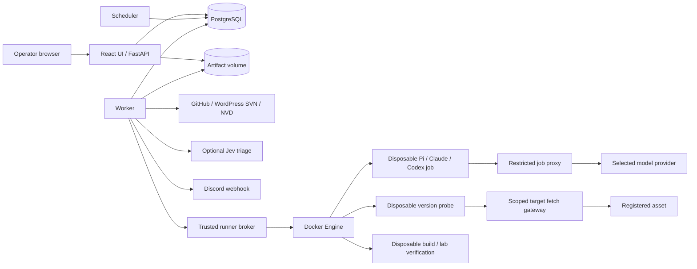

# Design document: Numen

Status: implementation baseline. Date: 2026-10-03.  
Product scope: [PRD](../prd/numen-prd.md). UI: [specification](../ui-spec/numen-ui-spec.md).  
Governing choices: [ADR-0001](../adr/ADR-0001-application-and-jobs.md), [ADR-0002](../adr/ADR-0002-agent-execution.md).

## Overview and requirement boundary

Implement one authenticated operator's path from a registered asset/software pair to a reviewed change or CVE and a reproducible finding. All application components and generated-code workloads run in Docker. Commit checks happen every configured X days. All listed features remain in scope; the user confirmed no exclusions and subsequently authorized the build. The [coordination contract](../implementation-contract.md) supplies the shared implementation interfaces.

The workspace started without an implementation. The backend, frontend, and runtime now implement this baseline with the adjustments recorded in the [coordination contract](../implementation-contract.md#verified-implementation-adjustments). [Repository and integration evidence](../references.md) distinguishes initial observations, primary-source behavior, and runtime verification. Monitoring defaults to seven days and remains operator-configurable; CVSS criteria and account credentials require configuration.

## Acceptance and traceability

The PRD's **AC-01 through AC-18** are the proposed acceptance contract. The design sections below identify the mechanisms satisfying them. The [verification strategy](#deployment-migrations-and-verification-strategy) selects the narrowest proof boundary for each group; the [work plan](../plans/20261003-feature-numen.md) supplies tasks and proposed commands.

## Selected architecture



The diagram shows logical routes. Network enforcement is specified below; arrows do not grant workloads access to the application network.

### Compose services and storage

| Service | Responsibility | Persistent access / exposed interfaces |
|---|---|---|
| `app` | Login, API, static frontend, validated settings, artifact reads | PostgreSQL, artifact volume, credential encryption key; only browser-facing port |
| `worker` | Upstream ingestion, triage, analysis coordination, notification delivery | PostgreSQL, artifact staging/promotion, selected credential resolution; internal broker client |
| `scheduler` | Enqueue due program checks and recover expired job leases | PostgreSQL; no generated-code execution |
| `db` | Domain records, sessions, jobs, delivery state | `postgres-data` volume; application network only |
| `runner-broker` | Create/reconcile bounded workload containers and collect outputs | Docker Engine socket, broker authentication secret; internal control network only |
| `fetch-gateway` | Bounded HTTP(S) target reads using per-job capabilities | Worker-issued target policy; no database, provider key, or Docker socket |
| Native login/import operations | On-demand Codex device login, Claude authorization-code login, and protected native cache ingestion through the worker/broker | Authenticated job/private credential channel and encrypted vault; not a public terminal |

The broker additionally creates a private network and restricted proxy for each agent job, and isolated build/lab containers for verification. Pi/Claude/Codex/probe/lab images are built and version-pinned alongside the Compose deployment. The Docker Engine and browser are deployment prerequisites; application processes require no host Python, Node, Pi, Claude, Codex, or PHP installation.

`artifact-data` contains immutable completed artifact sets and bounded staging directories. No job container receives that whole volume. Inputs are copied into its fresh workspace, and outputs are copied out through the broker after path/size validation. Secrets enter through protected job-local files or environment supplied by trusted code, never through prompt text or command arguments.

### Responsibility map

```text
backend/numen/
  api/                    auth, programs, commits, CVEs, findings, jobs, settings
  models/                 SQLAlchemy records and constraints
  jobs/                   scheduler, leases, handlers, recovery
  sources/                GitHub, WordPress SVN, snapshots, NVD
  agents/                 capability discovery, Pi/Claude/Codex/Jev adapters
  versions/               recipes, fingerprints, observations, comparators
  audit/                  orientation, function jobs, synthesis, freshness
  findings/               artifact manifests, lab verification
  notifications/          Discord delivery and event records
backend/migrations/       Alembic migrations
frontend/src/             React screens and shared interactions
runner/                   broker, fetch gateway, entrypoints, images
skills/trailofbits/        pinned skill/plugin content and licenses
prompts/                  versioned operation templates and output schemas
tests/                    unit, integration, browser, and fixture sources
compose.yaml              production/self-hosted runtime
compose.test.yaml         deterministic fixture/test overrides
Dockerfile                multi-stage UI/backend build
Makefile                  documented build, test, and setup entrypoints
```

The responsibility map groups related behavior; the implementation keeps some responsibilities together in `backend/numen/api.py`, `workflows.py`, `sources.py`, `domain.py`, and `queue.py` rather than requiring a directory per domain. Python/Node lockfiles and image digests pin dependencies. Runtime services remain modules of one application rather than separate product microservices.

## Data model

Use UUID primary identifiers, UTC timestamps, foreign keys, and immutable revisions for evidence-bearing outputs. Mutable operator decisions retain an action history. JSONB carries source-specific metadata; fields required for filtering, uniqueness, or state transitions remain typed columns.

| Record | Essential fields and constraints |
|---|---|
| `operator`, `sessions` | One operator; password hash; opaque hashed session token; expiration/revocation |
| `settings` | Monitoring days, default profile references, dashboard URL, webhook reference; configuration revision |
| `account_connections` | Provider, auth type, encrypted credential envelope, credential revision, health/expiry, capability snapshot timestamp |
| `integration_connections` | GitHub/NVD/Discord type, encrypted credential or webhook envelope, configuration revision, health; referenced by settings/source records |
| `agent_profiles`, `plugin_settings` | Agent/provider/account/model/effort; bundled package versions and enabled state |
| `programs` | Asset name/URL, product kind/identity, source kind/location/ref/path, source generation, interval, next check, pause/archive state, profile overrides, CVE policy and recipe reference |
| `source_cursors`, `source_snapshots` | Program and source generation; resolved Git SHA or SVN revision/path; completed-sync cursor; immutable archive hash; capture/coverage state |
| `commits`, `triage_results` | Unique `(program_id, source_generation, revision)`; source metadata/diff completeness; immutable triage input hash and result; operator review decision |
| `analyses` | Kind, triggering record, input references/hash, resolved profile, exact result category where applicable, evidence/report artifact references, job ID |
| `version_recipes`, `version_observations` | Immutable script/metadata/fixture hashes; program; recipe revision; status, version/candidates, evidence, confidence basis, checked time; manual-vs-script origin |
| `audit_contexts`, `audit_units` | Source snapshot, skill revision, scope/coverage, function-task records, dossier/artifact references, job IDs, unresolved work |
| `cves`, `cve_query_cursors` | CVE ID, source/raw record hash, published/modified time, scores/vectors/affected data; completed query cursor keyed by selector hash |
| `program_cves` | Unique `(program_id, cve_id)`; identity evidence/confirmation, score eligibility, version applicability, policy revision and analyzed input hash |
| `findings`, `finding_events` | Program, CVE or local 0day identity, title, operator status, affected/fixed versions and evidence, analysis references, artifact-set reference; status/link history |
| `artifact_sets`, `artifacts`, `lab_runs` | Immutable set revision, safe relative path, type, size, SHA-256, completeness; lab pinned input references/result and job ID |
| `jobs`, `job_attempts`, `job_events` | Kind/input hash/idempotency key; states, dependencies, profile snapshot, attempts, lease owner/token/deadline, heartbeat, timestamps, output references |
| `notification_outbox` | Stable event key, review item, webhook revision, delivery attempts/state, Discord message ID where known, error and next attempt |

Source URL/ref/path changes increment `source_generation` and establish a new baseline. Prior commits, contexts, and observations remain attached to their original generation. Archiving suppresses new scheduled work and retains findings/evidence.

Large source archives and artifacts are referenced by hash and path rather than duplicated into job JSON. Artifact promotion uses staged files, validation, atomic filesystem rename, and a committed metadata record; recovery removes orphaned staging and never exposes an incomplete set as complete.

## API and shared job contracts

All browser endpoints require the operator session except login and a minimal health endpoint. Cookie sessions use HttpOnly, SameSite, and Secure when HTTPS is configured. Mutating requests also require a CSRF token. The API returns cursor-paginated lists, UTC timestamps, and structured errors `{code, message, fields, retryable}`. Secret fields are write-only.

| API boundary | Contract / visible behavior |
|---|---|
| `POST /api/auth/login`, `POST /api/auth/logout` | Create/revoke server-side session; throttled password failures |
| `GET/POST /api/programs`, `GET/PATCH /api/programs/{id}` | Program configuration; dependent-source validation; computed health/last/next check |
| `POST /api/programs/{id}/checks` | Queue a manual program check; return `202 {job_id, status_url}` |
| `GET /api/programs/{id}/commits` | Cursor list with separate triage, review decision, and analysis fields |
| `POST /api/commits/{id}/review` | Save `pending` or `dismissed`; retain an event |
| `POST /api/commits/{id}/analyses` | Explicit operator submission; resolved profile and immutable before/after inputs; return job ID |
| `POST /api/programs/{id}/version-recipes`, `POST /api/programs/{id}/version-checks` | Generate a recipe or reuse the active validated revision |
| `POST /api/programs/{id}/audit-contexts` | Selected snapshot/focus/profile; return orchestration job ID |
| `GET /api/cves`, `POST /api/programs/{id}/cves/{cve_id}/analyses` | Separate eligibility/applicability; enforce the score/product gate before creating a job |
| `GET/POST /api/findings`, `PATCH /api/findings/{id}` | Finding and operator status; CVE linkage preserves original 0day history |
| `POST /api/findings/{id}/artifacts`, `POST /api/findings/{id}/artifact-generations` | Safe upload or agent generation into a new artifact revision |
| `POST /api/findings/{id}/lab-runs` | Explicit verification of a particular complete artifact set |
| `GET /api/artifacts/{id}/content`, `GET /api/artifact-sets/{id}/download` | Authorized preview/download; safe content types and filenames |
| `GET /api/jobs/{id}`, `GET /api/jobs/{id}/events`, `POST /api/jobs/{id}/cancel`, `POST /api/jobs/{id}/retry` | Truthful state/progress and bounded sanitized logs; retry creates another attempt with the same immutable input/profile |
| `/api/settings`, `/api/accounts`, `/api/plugins`, `/api/accounts/{id}/check`, `/api/accounts/{id}/capabilities` | Validated write-only credentials and redacted connection/plugin/profile state |
| `POST /api/settings/webhook/test` | Queue a named test event only when explicitly submitted |

Every operation submission accepts `Idempotency-Key`. Repeating a key with identical input returns the original job; different input with that key returns `409`. Validation failures return `422`, unauthorized access `401`, unmet current prerequisites `409`, and unavailable external services appear on the job instead of blocking an HTTP request.

Agent job profile:

```json
{
  "agent": "pi",
  "connection_id": "uuid",
  "provider_id": "commandcode",
  "model_id": "provider-catalog-id",
  "reasoning_effort": null,
  "capability_revision": "hash",
  "runner_image_digest": "sha256:digest",
  "plugin_bundle_hash": "hash",
  "prompt_revision": "hash"
}
```

The examples show application-owned schemas; identifier values are illustrative. Allowed coding-agent IDs are `pi`, `claude`, and `codex`. All three implement commit triage/analysis, version-recipe generation, audit orientation/function/synthesis, CVE analysis, and finding artifact generation through the shared contracts. Resolve and validate a profile at submission and record it immutably. Refresh missing/stale capabilities before submission; recheck connection usability before execution. A model removed after queuing fails with `model_unavailable`, and the operator can submit a new job with a compatible profile. Retrying a job keeps its profile/input; changing either creates a new job. A selected model is never silently replaced.

## Jobs, scheduling, and recovery

**States:** `queued → running → succeeded | failed | cancelled`; a running cancellation goes through `cancelling`. Retryable execution failures return to `queued` with an attempt record and future `available_at`. Unmet permanent prerequisites fail with a specific code. Composite operations also expose child-task progress and partial coverage.

1. The scheduler locks a due program, creates a uniquely keyed check for that scheduled time/source generation, and advances its scheduled due time in the same transaction. Coalesce missed intervals into one catch-up check, then schedule the next regular check X days from enqueue time. Suppress overlapping program checks; a manual request can return the already active check. Whole days mean elapsed 24-hour UTC periods, avoiding daylight-saving calendar ambiguity.
2. A worker claims a ready job in a short transaction, creates an attempt/lease token, and releases the transaction before external work. Heartbeat renewal is conditional on that token.
3. Commit import, recipe checks, and CVE sync record independent success/error timestamps. A program check can finish degraded; the UI does not report all stages successful if one failed. Missing recipe/CVE configuration is displayed as not configured, not as an external error.
4. Persist a source/query cursor only when its complete snapshot or pagination range is imported. Retrying an interrupted sync deduplicates by immutable IDs. Scheduled failures retry with capped backoff before the next regular interval; they do not wait another X days.
5. On application/broker restart, reconcile workload labels and lease tokens. An expired attempt is reclaimed only after its prior workload is stopped or confirmed absent. Fence all state/artifact publication by the active attempt token; late results remain historical and cannot overwrite the current result.
6. Cancellation marks the request, stops every owned container/child job, collects permitted partial output, and records `cancelled` only after reconciliation. A race with completed work is resolved by one database state transition.

Start with one concurrent expensive agent/lab job. Short source/notification work uses a bounded separate worker capacity so one context run does not delay all monitoring. Audit function fan-out shares the parent operation's concurrency and cumulative resource budget.

Automatic-job deduplication includes program, source generation, revision/CVE input hash, policy/profile revision, and operation kind. Operator re-analysis is a separately identified request. An external provider call may be repeated after an uncertain failure; record every attempt and available usage rather than promising exactly-once billing.

## Upstream source collection

### GitHub

Validate HTTPS GitHub repository identity and tracked branch/path. Resolve and pin the head SHA, collect metadata using the commit API, and use a constrained source collector to materialize before/after snapshots and full diffs. Traverse changes reachable from the new head but not the prior head; timestamp-only cursors cannot cover commits merged later with old author dates.

A first successful sync establishes the current head and displays historical commits without automatically treating all history as new security candidates. New import batches are the automatic triage input. Manual review can select an older displayed revision.

When the prior head is no longer an ancestor, retain both observations, import available unseen revisions, and expose a history discontinuity. When a parent/diff/path is unavailable, mark coverage incomplete. Large, binary, truncated, and merge diffs preserve their limitations; detailed analysis can choose Insufficient context. Checkout disables source-supplied hooks/config execution and supplies only the selected source credential.

### WordPress

Resolve the plugin slug to `https://plugins.svn.wordpress.org/{slug}/`. Monitor the selected subtree using SVN log XML and immutable revision numbers; use revision-pinned export/diff for context. SVN revision numbers are global, so gaps do not imply missing plugin changes. Map release tags and plugin metadata to software releases, without assuming trunk identifies the deployed version.

Label this source as WordPress release history. Support it independently of GitHub. A program configured to monitor a separate development repository retains that explicit source identity instead of silently merging the two histories. [WordPress source evidence](../references.md#github-and-wordpress)

## Commit triage and analysis

Triage inputs are bounded commit metadata, changed paths, diff sections, and a completeness flag. Results are `security_candidate`, `unrelated_change`, or `insufficient_context`. Missing context overrides an apparent unrelated classification. Each input/result is immutable and operator decisions are separate.

For Jev, send one typed Choice question through its evaluation API. The `state` contains the structured input; the question's `instructions` define what security relevance means, and its `criteria` map contains the three application labels with explicit descriptions. Preserve the returned choice, probability distribution, model version, and confidence if present. Jev does not generate the narrative report. [Jev API](https://docs.typesafe.ai/api)

Pi/Claude/Codex triage uses a read-only profile and returns the same application contract with explanation/evidence when available. AI triage disabled means no classifier job; the operator can manually nominate a commit. Candidate and insufficient-context review items remain visible. A candidate creates its Discord outbox entry transactionally.

Detailed analysis begins only from an explicit authenticated Analyze submission. Materialize the commit and its selected parent; for a merge, retain the comparison parent choice. Supply relevant source context, exact before/after references, and the audit context's revision/coverage. If a context is stale, either supply the required delta with its provenance or regenerate the necessary scope; the report must state any remaining gap.

Detailed commit result contract:

```json
{
  "category": "Likely vulnerability fix",
  "summary": "Evidence-grounded assessment",
  "before_ref": "immutable-reference",
  "after_ref": "immutable-reference",
  "evidence": [{"path": "src/file", "ref": "immutable-reference", "lines": [12, 18], "observation": "..."}],
  "affected_versions": [],
  "fixed_versions": [],
  "confidence": {"level": "medium", "basis": "..."},
  "open_questions": []
}
```

Validate the category against the four exact PRD labels and source citations against available inputs. Persist a Markdown report alongside the structured result. A malformed response fails validation; permit one bounded repair attempt using the validation errors and record that attempt. Creating/updating a finding is a separate operator decision.

## Accounts, plugins, and agent adapters

Maintain provider capability snapshots containing available model IDs, supported efforts, auth modes, and observation time. Global profiles, program overrides, and job overrides share this contract. `reasoning_effort=null` means provider-managed/default depth. Reject values outside the selected model's advertised supported set.

| Selection | Runtime behavior |
|---|---|
| Pi + DeepSeek/OpenAI/Claude | Selected built-in provider and connection, using its validated native auth mode |
| Pi + Command Code | Explicit pinned `pi-commandcode-provider` package and its discovered catalog |
| Claude Code + Claude | Native Claude Code model/auth selection; API-key and subscription-login execution modes are distinct |
| Codex CLI + OpenAI | OpenAI API-key or supported ChatGPT-login connection; model/effort capabilities validated for the selected auth mode |
| Jev triage | Separate HTTP adapter/model; no coding-agent tools or invented effort mapping |

For Pi use print/JSON mode, a job-specific session location, explicit model/provider/effort, and explicit tools/resources. Disable ambient context/skill/extension discovery and load only the profile's bundled resources. Parse final assistant output from the event protocol, then validate the application schema. The inspected local CLI supports these controls; pin/test the shipped version before relying on them. [Pi evidence](../references.md#pi)

For Claude Code use noninteractive structured output, a schema, and a profile-specific tool allowlist. Start outside the source checkout with a fresh user/config filesystem. Load bundled skills/plugin resources explicitly. API-key jobs can use bare mode; subscription jobs must use the tested native-auth path because bare mode bypasses subscription credentials. Never replace one auth mode with the other silently. [Claude evidence](../references.md#claude-code)

For Codex CLI, use `codex exec` with `--json`, `--output-schema`, `--output-last-message`, and `--model`. Set the selected effort through `model_reasoning_effort`; omit the override for model-default depth. Capture JSONL progress and require a completed turn, successful exit, and schema-valid final response before publishing results. Use a fresh container-local config/auth filesystem, trusted per-job overrides, and ephemeral sessions. Start outside the source checkout, set `project_doc_max_bytes=0`, and treat the source project as untrusted to suppress its instruction/config/hooks discovery. Load application-bundled skill inputs through the coordinator. Set noninteractive approval policy to `never`, with native `read-only` for inspection and `workspace-write` for artifact generation alongside the broker's outer filesystem/network limits. Verify these policies in the shipped container instead of silently bypassing them. [Codex execution evidence](../references.md#codex-cli)

Discover Codex picker-visible models and supported/default reasoning efforts through a short-lived internal app-server `model/list` request using the selected connection and pinned CLI protocol. Paginate the catalog, retain native effort identifiers, and use the same validated configuration for exec jobs. The app-server is a capability-discovery subprocess inside a container, not a new publicly exposed service. [Official model discovery](https://learn.chatgpt.com/docs/app-server)

Codex connection setup uses the native API-key or eligible ChatGPT flow through worker/broker login jobs. Where supported, `codex login --device-auth` avoids relying on a browser callback inside a headless job. Protected cache import is also available for Codex and Claude native connections. Ingest only the selected connection into the encrypted vault, remove temporary plaintext state, and recheck access under that auth mode. Shell inheritance excludes credential variables; repository builds, generated version scripts, and lab containers receive no model-provider credential. [Official authentication](https://learn.chatgpt.com/docs/auth)

API keys are encrypted with a Fernet authenticated encryption envelope. The generated master key is supplied to trusted application processes through protected deployment configuration and is never granted to workloads. Native login/import uses an authenticated job/private credential channel; it ingests only the selected connection and destroys temporary plaintext credential files. Refresh/export checks credential revision before persisting an update. No host credential directory is mounted automatically. Bootstrap password input is a separate Compose secret file.

The broker supplies only that job's credential to its runtime. Connection checks and job logs expose status/usage through allowlisted, redacted fields. Artifact publication scans for supplied secret values and rejects credential-bearing output. Provider usage/cost is nullable and labeled estimated where appropriate.

Bundle Pi plugins in runner images at pinned versions. Settings controls enabled resources for new jobs and displays health. Refresh a catalog without silently updating plugin code. A package upgrade rebuilds the image and records a new bundle hash. [Specified Command Code provider](https://github.com/patlux/pi-commandcode-provider/)

## Container execution and network boundary

The broker API accepts fixed job kinds, an attempt token, image/profile IDs from an application-owned allowlist, immutable input archives, limits, and a selected credential envelope. It does not accept arbitrary Docker options, host paths, mounts, images, network names, or executable command strings. The trusted entrypoint constructs argument arrays.

- `POST /internal/runs` creates or returns the run for an attempt token.
- `GET /internal/runs/{id}` returns bounded status/progress.
- `POST /internal/runs/{id}/cancel` requests termination/reconciliation.
- `GET /internal/runs/{id}/outputs` returns validated output metadata/bytes after completion.

Authenticate the worker/broker control channel using a service secret over the private control network. Only the broker mounts the Engine socket. Workload images run non-root with dropped capabilities, no-new-privileges, read-only root where applicable, a bounded workspace/tmp filesystem, and enforced CPU, memory, process, and time limits. Build/lab profiles receive narrowly defined writable paths, not a generally privileged specification.

Create an internal per-job workload network. For agent provider access, attach a trusted proxy to that network and a separate egress network; its allowlist contains the selected provider's validated endpoints. Configure the native runtime's proxy transport and prove that ignoring it results in denied direct egress. The proxy denies application-network destinations and prevents workload access to its control/configuration. It holds no model credential.

Version-recipe agents and probe scripts use the fetch gateway via an expiring job capability. The gateway permits only GET/HEAD to the registered target origin and explicitly configured asset origins, with request/response/time limits. Resolve and validate destinations and every redirect, block private/link-local/metadata ranges by default, and pin validated resolution for the request to address DNS rebinding. An operator-configured internal asset requires an explicit scoped network policy; the application control network remains inaccessible.

Target content and upstream code are untrusted inputs, including embedded agent instructions. Bundled job prompts identify them as evidence; runtime policy independently enforces what the job can read, write, and contact.

## Version recipes and observations

Recipe bundle:

```text
version-recipe/
  determine_version.py
  recipe.json
  fingerprints.json
  fixtures/
```

`recipe.json` records product/source identity, recipe/schema revision, allowed evidence paths/origins, required runtime packages, supported methods, corpus coverage, and script/fingerprint hashes. Build a release fingerprint corpus from pinned upstream releases and actual distributed assets. Compare stable bytes; record normalization and transformations instead of claiming arbitrary CDN/minified files match a source release.

The script reads a runner-supplied input JSON file, uses the scoped fetch client, writes exactly one result object, and writes diagnostics to a separate bounded channel. Runner dependencies are locked and built into the probe image; scripts cannot install dependencies while checking a target.

```json
{
  "schema_version": 1,
  "status": "ambiguous",
  "version": null,
  "candidates": ["1.2.0", "1.2.1"],
  "method": "asset_hash",
  "evidence": [{"url": "https://asset.example/file.js", "sha256": "hash", "observation": "Same bytes in both known releases"}],
  "confidence": {"level": "low", "basis": "One shared fingerprint"},
  "limitations": ["Corpus covers two releases"]
}
```

Statuses are `detected`, `ambiguous`, `unknown`, and `error`. The runner supplies authoritative timestamps/recipe references. Known matching versions are candidates within the corpus; incomplete coverage is visible. Fixture checks exercise disclosed-version parsing, unique/shared hashes, transformed bytes, conflicting signals, denied redirects, and unavailable targets. Automated validation activates a recipe revision; generating it does not require an additional invented approval step. Subsequent checks reuse it without another agent call.

## Audit context workflow

Pin a portable Trail of Bits skill/plugin snapshot and preserve its license/revision. Expose the requested entry document plus the supporting per-function documents. Use one application-coordinated orientation/function/synthesis pipeline for Pi, Claude Code, and Codex CLI, adapting the pinned instructions and structured return contract. Loading only a skill name is not proof of workflow execution.

1. Orientation produces a source-referenced map and a manifest of the selected significant functions/focus scope.
2. The coordinator dispatches per-function jobs using the pinned analysis instructions and structured return contract through the selected Pi, Claude, or Codex adapter. Each child receives the source snapshot, function identity, companion skill resources, and an output location. The pipeline preserves delegated analysis without requiring a CLI to execute an unverified native workflow command.
3. Persist full function documents to artifacts and return compact records to synthesis. Track selected, completed, failed, and omitted units; bounded concurrency and cumulative operation limits apply.
4. Synthesis emits the dossier, structural assumptions, evidence references, and open questions. Produce `audit-context-building.md` as the entry document referencing that dossier and its function documents.

A report is current only relative to its exact pinned snapshot/scope. Partial coverage and stale context remain explicit. Detailed investigations consume applicable context plus a documented source delta. The [inspected skill](../references.md#trail-of-bits-audit-context-building) determines the analysis content; the architecture adds provenance, persistence, and job lifecycle.

## CVE ingestion, gates, and applicability

Use the NVD CVE API as the initial monitored source. Preserve raw records and source timestamps; parse optional versioned metric arrays (`cvssMetricV30`, `cvssMetricV31`, `cvssMetricV40`) and available affected/configuration data. Pin an official schema fixture but tolerate additive fields. [Official NVD schema](https://csrc.nist.gov/schema/nvd/api/2.0/cve_api_json_2.0.schema)

Query by a stable product selector, paginate complete results, and refresh changed records using a completed last-modified cursor with overlap and deduplication. A first sync retrieves the selected product's available records; it does not require mirroring every NVD record. Check current date/query limits and rate behavior when implementing the connector; split requested ranges accordingly. A change to selectors establishes a new query cursor. API outages preserve the last completed cursor and visibly delay coverage.

Product matching accepts an exact configured product/CPE identity or an operator-confirmed mapping supported by source/registry references. Name/keyword matches are candidates until confirmed. Do not infer an exact WordPress slug from an unrelated textual product name.

For each confirmed product match compute:

```text
eligible = criteria_configured
           AND record_not_rejected
           AND any(score.version in selected_versions
                   AND score.kind == Base
                   AND score.value >= minimum_base_score)
```

Validate scores as decimal values in `[0,10]` and retain the witness source/vector. The gate applies to manual and automatic CVE-analysis submissions. Before execution, re-evaluate current score/product/policy inputs. If the record/policy changed, stop that attempt with `input_changed` or `criteria_not_met` and schedule a fresh eligible job only under the current policy. Already running analyses retain their input snapshot and are marked superseded when relevant records change.

Automatically analyze only when the operator enabled that setting and a valid profile exists. Repeated records are deduplicated by analysis-relevant hash; administrative changes alone do not spend another agent run. Newly eligible or materially changed records create a visible event and, when enabled, a new analysis request.

The CVE agent result contains `cve_id`, `source_record_hash`, `summary`, `affected_versions`, `fixed_versions`, `evidence` in the same cited format as commit analysis, `confidence`, and `open_questions`, plus `report.md`. Product eligibility and remote applicability are supplied as deterministic input facts with their evidence; the agent's narrative does not replace those fields. The four commit categories are not reused as a CVE verdict enum.

Compute remote applicability separately. Use a declared version scheme and trusted comparator: SemVer for explicitly SemVer products; PHP's `version_compare` semantics for WordPress versions, invoked through a bundled trusted comparator. Apply inclusive/exclusive bounds and compound configuration logic. Missing environmental conditions, unsupported vendor ordering, ambiguous remote candidates, or absent version evidence produce Unknown. Agent explanations cannot override the deterministic score gate.

## Findings and reproducible artifacts

Findings are operator-created or operator-confirmed from an analysis. Store the original local identity even if a CVE is later linked. Keep upstream status/fixed versions, observed-target applicability, artifact completeness, and lab verification as distinct fields.

Completed bundle:

```text
finding-id/revision/
  manifest.json
  poc.py
  report.md
  vulnerable-app/
    Dockerfile
    compose.yaml
    README.md
    application.lock.json
    fixtures/
```

`manifest.json` lists file SHA-256/size/type, program/source/analysis references, declared vulnerable version, generation profile, and reproduction prerequisites. `application.lock.json` pins source refs and relevant base/dependency digests or includes exact required local inputs. A PoC and Docker stub with unavailable software remain a Draft bundle, not a reproducible completed finding.

Validate uploads and generated archives for path traversal, symlinks/hardlinks, unexpected device files, size limits, and declared required files. Render Markdown with HTML sanitization; serve executable files as downloads/source text. Every artifact revision is immutable.

Verification builds the declared vulnerable application through the broker's isolated build profile with bounded approved registry access and no real credentials. After dependency acquisition, start the vulnerable service and PoC container on an internal lab network with outbound access disabled. Use dummy fixtures and pin the executed input set. The PoC's target is the lab service; no registered remote asset is substituted. Record health, exit status, declared success conditions, observed evidence, and reproduction limitations. Verification success means those conditions were observed for this pinned artifact set; it does not prove every claim in the report.

If prerequisite source/licenses/dependencies are missing, preserve partial artifacts and name the missing inputs. A later upload or regeneration creates another revision; it does not overwrite the failed verification evidence. Fixed-target status requires operator confirmation and deployment evidence rather than an upstream version string alone.

## Discord delivery

Create an outbox record with the candidate/CVE event in the same transaction. Send a bounded embed containing program, revision/CVE, reason/score, and an authenticated dashboard URL. Set `allowed_mentions` to suppress parsing and use a confirmation response to retain the returned message ID. Never include source credentials, webhook tokens, PoCs, or raw private report content. [Discord resource](https://docs.discord.com/developers/resources/webhook)

The delivery job retries rate/transient errors using provider delay signals and capped backoff. Authorization/deleted-webhook failures become visible configuration errors. If acknowledgement is lost after Discord accepted a message, delivery can be uncertain; a retry can duplicate a message. Stable event identity and stored message IDs permit reconciliation where possible, but the system does not promise exactly-once webhook delivery. Notifications never submit the operator's analysis decision.

## Deployment, migrations, and verification strategy

Provide multi-stage builds, pinned manifests, Compose health checks, persistent volumes, and a one-shot migration/setup service. Run migrations before API/worker/scheduler start. Bootstrap/reset the single operator through a container command using protected input. Bind the browser port to loopback by default; a configured HTTPS reverse proxy enables remote use. Internal database, broker, and gateway ports are not published.

Back up PostgreSQL, immutable artifacts, and the credential master key as one consistent recoverable set; document container-based backup/restore. Replacement uses compatible migrations and preserves historical evidence. Recovery tests exercise worker/broker restarts and artifact promotion, not just database reachability.

The following proof boundaries are implemented through the Makefile, backend/runner/frontend suites, and controlled Docker journey. Credentialed provider compatibility is a separate operator configuration check. Current execution evidence is recorded in [verification](../verification.md).

| Claim / PRD AC | Level | Planned proof | Pass condition |
|---|---|---|---|
| Login/program persistence: AC-01, AC-02 | L2 | API + real PostgreSQL integration tests | Unauthorized writes/reads fail; saved configuration survives restart |
| Monitoring/history: AC-03, AC-04 | L2 | Fixture GitHub server and SVN repo; real worker/DB | Complete unseen revisions imported; partial/forced history is truthful; triage-off produces no AI jobs |
| User decision and category: AC-05, AC-06 | L2 + one L3 flow | Fixture classifier/agent plus browser review flow | Alert creates review item; link visit creates no analysis; explicit submit retains selected profile/category |
| Agent boundary: AC-06, AC-13, AC-14, AC-18 | L2, real containers | Contract fixtures, proxy allow/deny, secret isolation, timeout/cancel/restart checks | Correct invocation/parsing; workloads cannot reach DB/socket; limits and recovery observed |
| Recipe/context: AC-07, AC-08 | L1 + L2 | Version fixtures; recipe reuse in a real probe; small source fixture through audit coordinator | Ambiguity retained; no extra generation call; pinned context/supporting files and partial coverage |
| CVE criteria: AC-09, AC-10 | L1 + L2 | Score/range/configuration fixtures and real queue dispatch | Boundary scores correct; manual and automatic gates hold; modified/unknown records handled |
| Findings/labs: AC-11, AC-12 | L2 | Artifact validation plus actual vulnerable fixture build/PoC run | Complete bundle downloads; upload is passive; lab result belongs to pinned version; upstream fix does not close target |
| Settings/Discord: AC-13–16 | L2 | Provider/plugin/webhook mocks plus connection smoke checks | Disabled/expired choices rejected; inheritance preserved; delivery failure/uncertainty visible |
| Docker/recovery: AC-17, AC-18 | L2 + final L3 | Clean Compose build, restarts, backup/restore, final operator journey | No host application runtime needed; history/files/session policy/job truth preserved |

Use deterministic native-CLI fixtures to prove command/stream handling without paid calls. A credentialed one-operation smoke check for each selected provider/auth mode proves actual compatibility; it is an explicit implementation step and any unavailable account is reported as an unverified integration. Keep production targets and channels out of routine automated tests.

## Implementation approach and material risks

Use a hybrid sequence: a small persisted/login foundation, then an observable monitoring/review slice, followed by the shared isolated agent contract, reusable version/context operations, CVE analysis, and finding labs. Shared profiles and broker inputs must exist before every agent-backed feature; source snapshots must exist before evidence-producing analysis.

| Risk | Current response / required proof |
|---|---|
| Model/CLI/plugin behavior changes | Pin shipped builds and run protocol/capability/auth smoke checks |
| Proxy transport or Docker limits differ by host | Prove constrained network access and timeout/OOM/cancel before accepting agent execution |
| Trail of Bits native workflow differs between runtimes | Coordinator adapter proves orientation, per-function results, and synthesis against the pinned skill |
| Remote assets are modified or fingerprints overlap | Preserve unknown/candidate results and corpus coverage |
| CVE source metadata/matching is incomplete | Expose selector/source health, require confirmed identity, and preserve unknown applicability |
| Discord/provider side effect succeeds without acknowledgement | Record uncertain outcomes/attempts; avoid exactly-once claims |
| Lab source/dependencies are unavailable | Draft/unverified bundle with explicit prerequisites rather than fabricated reproduction |

## References and update history

The [PRD](../prd/numen-prd.md), [UI spec](../ui-spec/numen-ui-spec.md), proposed ADRs, and [evidence register](../references.md) govern this design. Initial version written 2026-10-03; amended the same day to include Codex CLI across agent-backed workflows. Runtime claims remain subject to the work plan's proofs.
